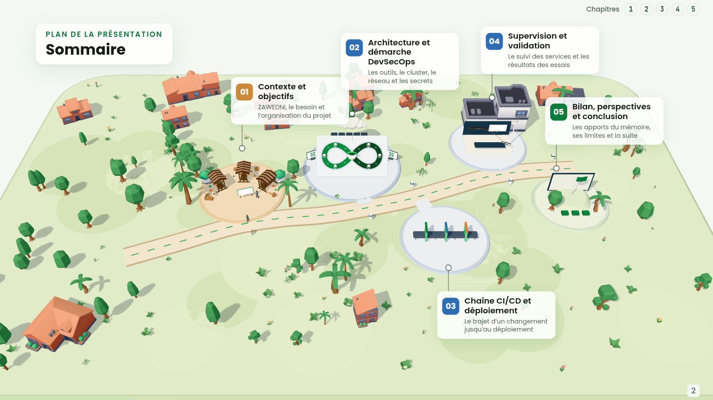

# ZAWEDNI · A DevSecOps journey in 3D

A French-language presentation of **ZAWEDNI**, a web and mobile platform for local purchasing and responsible supplier evaluation. A guided 3D world connects the platform, its architecture, delivery pipeline, and monitoring, with synchronized speaker notes in a separate window.

**35 slides · 5 chapters · 86 presentation states · approximately 20 minutes**



## Run locally

Install **Node.js 20.20+** and **Python 3.9+**, then run these commands from the repository root:

```bash
npm ci
npm run build
python3 -B scripts/serve.py --port 4320 --directory dist
```

Open [the presentation](http://127.0.0.1:4320/) and [the speaker notes](http://127.0.0.1:4320/presenter.html) in the same browser. Use a browser with WebGL support; Google Chrome is used for automated verification.

Models, fonts, screenshots, and the 90-second video are bundled locally. Once dependencies are installed and the build is ready, presenting requires no network access. The Python server supports video seeking and listens on your own computer only.

### Two screens on Linux

With Google Chrome, `curl`, and `xrandr` installed, the launcher opens the presentation on the external display and the notes on the laptop:

```bash
./present.sh
./present.sh --swap  # Reverse the two displays
```

Use extended displays for separate windows on each screen. With one display, both windows open on the same screen. To change the port, use `ZS3D_PORT=4321 ./present.sh`. The launcher checks the build before opening it; rebuild after changing the source.

## Presenting

| Key | Action |
| --- | --- |
| → / Space / PageDown | Next state or reveal |
| ← / PageUp | Previous state |
| 1–5 | Jump to a chapter |
| Home / End | Opening / conclusion |
| F | Toggle fullscreen |
| N | Open speaker notes |
| M | Toggle reduced motion |
| L | Toggle lighter rendering |
| + / − in speaker notes | Adjust note size |

The speaker window follows the current slide and reveal, with direct navigation to any state. Click its timer to reset it.

The video is on slide 34. Advancing to its reveal starts playback, or shows a play button if the browser blocks autoplay. Native controls provide pause, volume, and seeking. Leaving the video stops and rewinds it; speaker notes remain silent.

The complete French script, including stage cues, is in [the speaker script](docs/SCRIPT-ACTUEL.md).

Additional guides cover [presenter setup](PRESENTER.md), [timing](docs/DUREE-20MIN.md), and the [slide-to-state mapping](docs/CORRESPONDANCE-COURTE.md). For animation maintenance, see [local slide reveals](docs/ANIMATIONS-SLIDES.md) and [delivery-line motion](docs/LIGNES-CHAPITRE3.md).

## Development and checks

```bash
npm run dev        # Development server: http://127.0.0.1:5317
npm test           # TypeScript tests and Python server tests
npm run build     # Asset/content checks, strict TypeScript checks, production build
npm run notes     # Regenerate the speaker script from the active presentation
```

With the built presentation served on port 4320 and Google Chrome installed:

```bash
npm run verify           # All 86 states, speaker synchronization, local resources
npm run verify:launcher  # Launcher behavior with simulated display geometry
npm run verify:media     # Native playback and seeking; also requires ffprobe
npm run verify:slides    # Chapter markers and slide numbers across three viewport sizes
npm run verify:animations # Local reveal effects, interruption, and reduced motion
npm run verify:lines     # Delivery-line progression, reversal, and reduced motion
```

Browser reports are generated in `review/`, which is excluded from Git. Automated browser checks use software rendering; rehearse with the actual projector and audio equipment to check presentation performance.

## Project layout

| Path | Purpose |
| --- | --- |
| `src/` | 3D world, camera, navigation, slides, media, and speaker view |
| `public/` | Local assets, exported slide frames, fonts, video, and asset notices |
| `content/source/` | Active slide sequence, exact speech, and asset fingerprints |
| `content/reference/` | Validated reference deck, speech snapshots, and verification manifest |
| `scripts/` | Build checks, local server, note export, and browser verification |
| `tests/` | Content, navigation, animation, media, build, and server regression tests |
| `docs/` | Speaker script, presentation guides, animation notes, and preview |

The active content preserves the validated speech and slide order. Verification compares all 86 states with their recorded frame fingerprints and notes. The full local `content/reference/classic-final/` snapshot is protected and ignored by Git; public clones build and verify using the portable reference files included here.

## Credits and rights

Presentation by **Ali Zribi**, for the ZAWEDNI project at ISIMa.

Asset credits and bundled license notices are in [public/licenses](public/licenses/README.md). The included Kenney and Quaternius models, fonts, and Three.js retain their respective licenses. ZAWEDNI/ISIMa logos, project screenshots, and the film are presentation materials and are not covered by the models’ CC0 licenses. No project-wide open-source license is granted by this repository.
